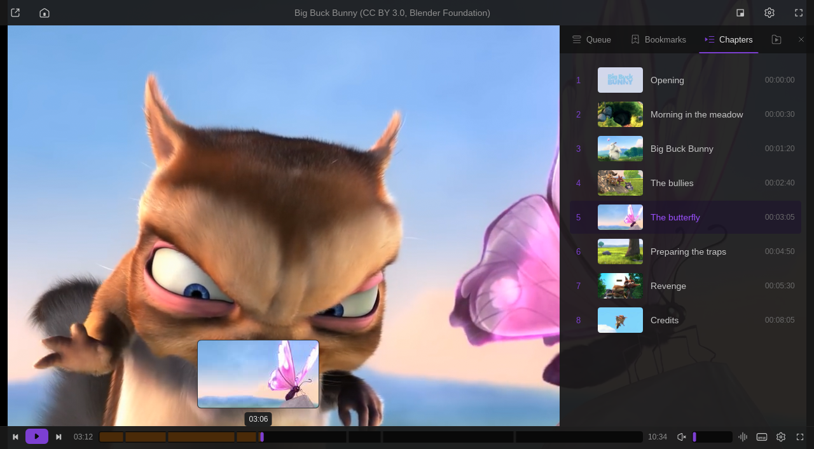

# Chapters & Previews

(Plugin id `chapter-thumbnails`; called Chapter Thumbnails before 1.2.0.)

Seek-bar hover previews and chapter pictures for local videos. This plugin is what provides
the seek-bar previews in Vivi (Vivi suggests installing it once, the first time you hover the
seek bar without it). Since 1.2.0 it also makes **scene chapters** for videos without chapters (formerly the Scene Chapters plugin). Implements #75 and #62. Needs Vivi 0.9.2 or later, which
displays the images.

* **Seek bar**: 192×108 frames, evenly spaced; hovering the seek bar shows the nearest one.
  *Auto* makes one every 10 seconds (25 to 200 per file: 63 for a 10-minute video, 200 for
  a film); 25, 50, 100 or 200 can be chosen instead, and short clips get at most one per
  second. Frames are made with fast keyframe seeks, two at a time, coarse to fine, so a few
  spread-out previews appear within a second and the rest fill in.
* **When**: *On hover* (default) starts when the pointer first goes over the seek bar of a
  file. *On open* prepares them in the background instead, after 10 seconds of playback of a
  video longer than 3 minutes, with ffmpeg at the lowest CPU and disk priority (`nice` /
  `ionice` on Linux, `nice` on macOS). Opening another file stops the work; an unfinished
  set is redone next time. Vivi versions that still make their own built-in previews don't
  report the hover: use *On open* or *Generate* there.
* **Chapters**: one 320 px picture per chapter (one second after its start) in the side
  panel's Chapters tab, made when the file opens, also for chapters added later by scene
  detection or SponsorBlock (pictures whose chapter moved are redone). `Alt+H` shows the
  chapter list (time, title, current chapter) on screen.
* **Cache**: `~/.local/share/vivi/plugin-data/chapter-thumbnails/<key>/` (`seek-NN.jpg` +
  `seek.meta`, `chapter-N.jpg` + `chapters.meta`), key = hash of path, size and
  modification time, so an opened-again file shows its previews instantly. The least
  recently used files are removed beyond 200 files or 500 MB (both adjustable; a file
  takes about 0.5 MB). *Clear* deletes the current file's thumbnails, *Clear all* the whole
  cache.
* **ffmpeg**: a system `ffmpeg` is used when present. Otherwise (and in the Flatpak)
  Vivi's **media ffmpeg build** is downloaded once from release `helper-ffmpeg-v8.0-2`
  (Linux x86_64 / ARM64, Windows x64, macOS Apple silicon; about 15 MB for ffmpeg +
  ffprobe, checked against the sha256 pinned in the script) into
  `plugin-data/shared/ffmpeg-media`, shared with Subtitle Auto-Sync. It decodes H.264,
  HEVC, VP8/VP9, MPEG-1/2/4 and MJPEG; for other codecs such as **AV1** the plugin says so
  once instead of failing silently: install ffmpeg on the system (with dav1d) for those.
* Audio files (also with cover art), streams and videos shorter than a second are skipped.

## Scene chapters

For local videos without chapters of their own, ffmpeg finds the scene changes and they
become `Scene 1`, `Scene 2`, … chapters (with pictures, like any chapter).

* **When**: `Alt+J`, *Video → Detect scene chapters*, the command palette or *Detect* in
  the settings; `Alt+J` again while it runs cancels. *Scene chapters: detect scenes
  automatically* (off by default) scans every such video one second after it opens.
* **How**: `select='gt(scene,T)'` on a 160 px wide copy, no audio, at the lowest CPU and
  disk priority. *Scene scan*: **Every frame** (default) finds every cut; **Keyframes
  only** decodes just the keyframes, about 10× faster (a 10-minute 720p60 film: 24 s →
  2 s) and finds fewer but real cuts. *Threshold* (0.1–0.9, default 0.4): lower finds
  more. *Minimum scene chapter length* (default 30 s), also from the start and the end.
* **Other chapters**: videos with chapters of their own are left alone. Chapters other
  plugins add (SponsorBlock on a downloaded YouTube video) are kept and merged in time
  order, whether they arrive before or after the scan.
* **Cache**: `<key>/scenes.json` next to the thumbnails (every cut with the threshold and
  scan used, so a new minimum length applies at once; another threshold scans again).
  Scans made by the old Scene Chapters plugin are reused. *Forget* removes the scene
  chapters of the playing video and its scan; *Clear* removes it with the thumbnails.
* **From Scene Chapters**: Scene Chapters 1.1.1 notices this plugin, leaves `Alt+J` and
  automatic scans to it, copies its non-default settings here once, and can then be
  uninstalled.

## Settings

| Setting | Default | |
| --- | --- | --- |
| Seek-bar hover thumbnails | on | |
| Chapter thumbnails (Chapters tab) | on | |
| Generate seek-bar thumbnails | On hover | or On open |
| Seek-bar thumbnails per file | Auto | one per 10 s, 25 to 200; or 25 / 50 / 100 / 200 |
| Download ffmpeg when none is installed | on | |
| Files kept in the thumbnail cache | 200 | 50 / 1000 |
| Thumbnail cache size limit (MB) | 500 | 100 / 2000 |
| Scene chapters: detect scenes automatically | off | |
| Scene scan | Every frame | or Keyframes only |
| Scene change threshold | 0.4 | 0.1–0.9 |
| Minimum scene chapter length (s) | 30 | |

Actions: **Generate** (this file, now), **Show** (chapter list, `Alt+H`), **Clear** (this
file), **Clear all** (the whole cache, with the space freed), **Detect** (scene chapters,
`Alt+J`), **Forget** (this file's scene chapters).
