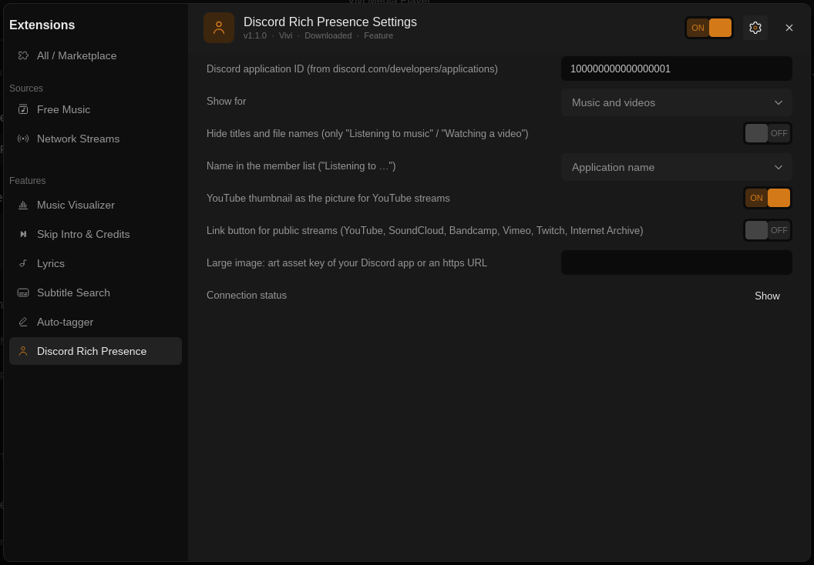

# Discord Rich Presence

Shows what Vivi plays in your Discord status: the title and artist (album as the picture's
tooltip), "Listening to" for music and "Watching" for videos, a progress bar (or *Paused*),
the YouTube thumbnail for YouTube streams and, if you want, a link button. Implements #57;
was built into Vivi up to 0.9.0, a downloadable plugin with a native helper since 0.9.1.

## Setup

1. Create an application at <https://discord.com/developers/applications>. Its name is
   what Discord shows ("Listening to **Vivi**"), so call it e.g. *Vivi*.
2. Copy its **Application ID** into *Application ID* in the plugin settings
   (Settings → Extensions → Discord Rich Presence).
3. Keep the Discord desktop app running on the same computer (also Flatpak / Snap Discord
   and Vesktop). *Connection status → Show* tells whether the helper reached Discord.

## Settings

| Setting | Default | What it does |
| --- | --- | --- |
| Show for | Music and videos | *Music only* clears the status while a video plays. |
| Hide titles and file names | off | Only "Listening to music" / "Watching a video" (and *Paused*); no titles, artists, pictures from the stream or links. |
| Name in the member list | Application name | Discord shows "Listening to *Vivi*" next to your name; *Title* or *Artist* shows the song or video there instead. |
| YouTube thumbnail | on | For YouTube / YouTube Music streams the video's thumbnail (`i.ytimg.com`) is the picture, your own image (below) becomes the small badge. |
| Link button | off | A button that opens what you play, only for public sites (YouTube, YouTube Music, SoundCloud, Bandcamp, Vimeo, Twitch, Internet Archive) and as a clean link (YouTube rebuilt from the video id, query strings and fragments dropped). Discord does not show your own buttons to you, only to others. |
| Large image | empty | An art asset key uploaded to your Discord application (*Rich Presence → Art Assets*) or an `https://` image URL. |

## What is sent to Discord

Only to the Discord app on this computer (its local IPC socket; nothing goes to the
internet from Vivi): the activity type (listening / watching), the title, the artist (for
internet radio the station name), the album as tooltip, start and end time while playing,
the picture (your image, or the YouTube thumbnail URL) and, when turned on, the link
button. Discord then shows this to people who can see your status.

* File paths, folders and stream URLs are never sent. A title that is only a file name
  loses its extension; a title that is a URL (a stream without tags) becomes the file name
  or host only, without user name, password, port, query string (e.g. `api_key=`) or
  fragment.
* Nothing is shown when nothing plays, when a file has finished, or for a still image.
* The helper logs connection states only (no titles, paths or IDs besides mpv's socket).

## How it works

`discord.lua` turns on mpv's JSON IPC (`input-ipc-server`) and starts the native helper
`bin/vivi-discord` (sources: `helpers/src/bin/vivi-discord.rs`, `helpers/src/discord.rs`).
The helper polls mpv once a second over IPC and sends `SET_ACTIVITY` frames to Discord's
local IPC socket (`discord-ipc-0`…`9` in `$XDG_RUNTIME_DIR`, `$TMPDIR` or `/tmp`, also
under `app/com.discordapp.Discord/`, `snap.discord/` and Vesktop's Flatpak folder;
`\\.\pipe\discord-ipc-N` on Windows), at most 5 updates per 20 s (Discord's own limit),
retrying every 15 s while Discord is closed. The timer follows the playback speed.
Flatpak Vivi has access to `xdg-run/discord-ipc-0` and `xdg-run/app/com.discordapp.Discord`.
