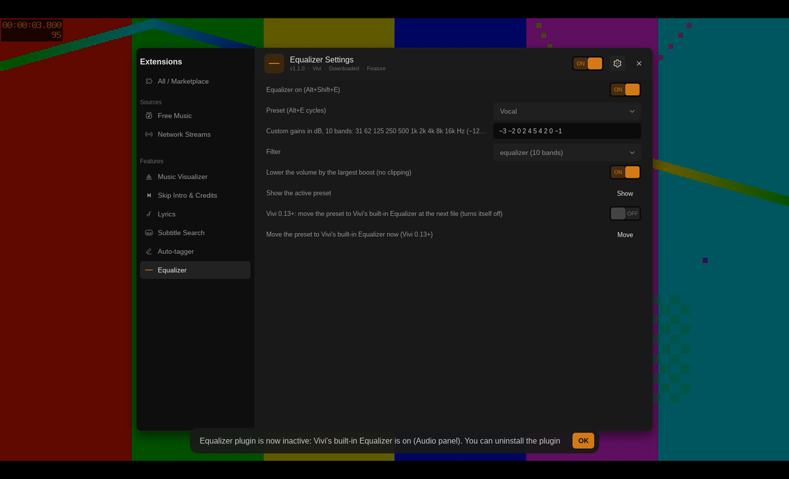
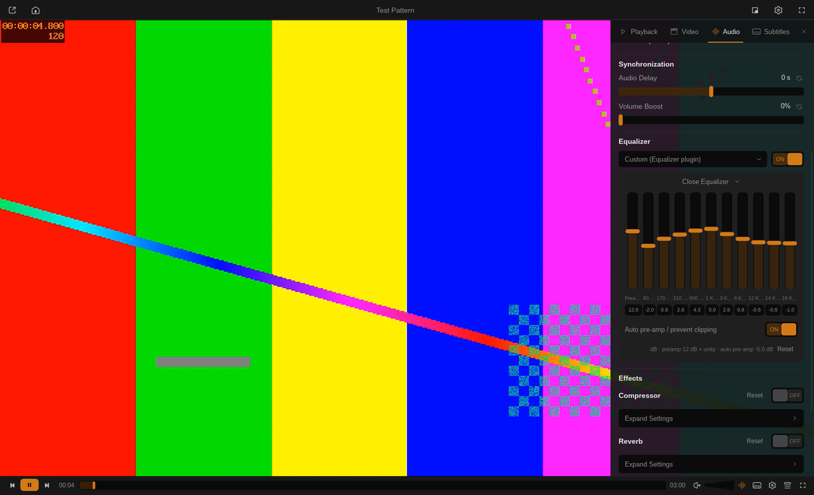

# Equalizer

> **Deprecated — built into Vivi since 0.13.0.** The built-in Equalizer (player side
> panel → Audio → Equalizer) replaces this plugin: 10 bands, VLC presets plus Bass, Vocal,
> Rock and Night, custom presets with import / export, `Alt+E` to cycle presets,
> `Alt+Shift+E` to turn it on / off and *Auto pre-amp / prevent clipping*. Uninstall this
> plugin in Extensions → All / Marketplace; it stays here for older Vivi versions and is
> no longer listed in the marketplace (its page remains).

Presets and a custom 10-band equalizer applied with mpv audio filters. Implements #74.
Requires Vivi 0.9.0+ (remembering `Alt+E` / `Alt+Shift+E` choices needs 0.9.1+). No
network, no files, no helpers, no ffmpeg binary (the filters are part of mpv's
libavfilter).

## On Vivi 0.13.0 and newer

Vivi sets `user-data/vivi/equalizer`; the plugin then applies no filter of its own (up to
1.0.1 it kept its filter on top of the built-in one, so both boosts added up and
`Alt+Shift+E` — taken by Vivi — could not turn the plugin's off). At the first file it
moves your setting over once:

* Bass, Vocal, Rock or Night: the built-in preset of the same name is selected and the
  built-in Equalizer turned on.
* Custom: your ten gains, resampled from the plugin's octave bands (31 Hz … 16 kHz) to
  the built-in bands (60 Hz … 16 kHz), become the preset *Custom (Equalizer plugin)*.
* Flat or off: nothing is moved. An equalizer you already turned on in Vivi is never
  replaced; a toast says the plugin is inactive.

A toast tells you what happened. The *Move* button in the plugin's settings moves the
preset again on request (also over an equalizer that is on), and *move the preset … at
the next file* turns itself off after the first move.

## On older Vivi

| Preset | 31 | 62 | 125 | 250 | 500 | 1k | 2k | 4k | 8k | 16k |
| --- | --- | --- | --- | --- | --- | --- | --- | --- | --- | --- |
| Flat | 0 | 0 | 0 | 0 | 0 | 0 | 0 | 0 | 0 | 0 |
| Bass | +6 | +5 | +4 | +2 | 0 | 0 | 0 | 0 | 0 | 0 |
| Vocal | −2 | −2 | −1 | +1 | +3 | +4 | +4 | +2 | 0 | −1 |
| Rock | +5 | +3 | +1 | −1 | −2 | −1 | +1 | +3 | +4 | +5 |
| Night | −6 | −5 | −3 | −1 | +1 | +2 | +2 | +1 | 0 | −1 |
| Custom | your ten values (dB, −12…12; `-` or `−`) | | | | | | | | | |

* `Alt+E` cycles the presets, `Alt+Shift+E` turns the equalizer off and on, each with a
  Vivi toast. Both are saved as plugin settings, so the choice survives restarts.
* *Filter*: `equalizer` = ten ffmpeg peaking filters, one octave wide; `superequalizer` =
  ffmpeg's 18-band FIR equalizer with the ten gains interpolated over frequency.
* *Lower the volume by the largest boost*: a pre-amp (`volume=-<max>dB`) so boosted
  presets do not clip.
* The filter is labelled `@vivi-eqplug`, separate from the Audio panel's EQ
  (`@vivi-eq`). Night pairs well with the Night Mode plugin (dynamic range compression).

## Version history

- **1.1.0** (2026-10-20): on Vivi 0.13+ no own filter on top of the built-in Equalizer;
  the preset moves there once (Bass / Vocal / Rock / Night select the built-in preset, a
  Custom curve becomes *Custom (Equalizer plugin)*, never over an equalizer that is on),
  with a *Move* button and a setting for it. Fixes: custom gains written with `−` (as in
  the setting's own title) were read as boosts; an unknown preset name showed its name
  but played Flat (now shows Flat); Vivi toasts instead of mpv OSD text (hidden under
  Vivi's UI).
- **1.0.1** (2026-10-18): deprecated in favour of Vivi 0.13.0's built-in Equalizer.
- **1.0.0** (2026-10-15): first release: Flat, Bass, Vocal, Rock and Night presets,
  custom 10-band EQ (equalizer or superequalizer), anti-clipping pre-amp, remembered
  across restarts.
