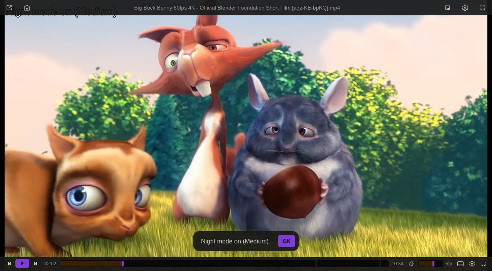

# Night Mode

Compresses loud scenes and lifts quiet dialogue so films stay understandable at low volume (mpv `dynaudnorm` / `loudnorm`). Implements #60.

Install: Vivi → Settings → Extensions → Browse → **Install**. Requires Vivi 0.9.0+.

## Keys

| Key | |
| --- | --- |
| `Alt+N` | Night Mode on / off for this session (a toast confirms, e.g. *Night mode on (Medium)*) |

## Settings

- **Night mode on**: state at startup when no schedule is set; applied live.
- **Strength**: *Light* / *Medium* / *Strong* (`dynaudnorm`), or *Loudness (EBU R128)* (`loudnorm`). Changing it while off only reports what will be used.
- **Schedule**: a time window such as `22:00-07:00` (may cross midnight; `21-23:30` works too). Night Mode turns on when the window starts and off when it ends, with a toast; at startup it follows the window. `Alt+N` still overrides it until the next start or end. Empty: off.
- **Only for videos**: the filter is left out while music or other audio-only files play (cover art does not count as video) and comes back for the next video, without changing the on/off state.

The filter is added as `@vivinight` to mpv's `af` chain. Script message `script-message-to night_mode toggle` toggles it too.
