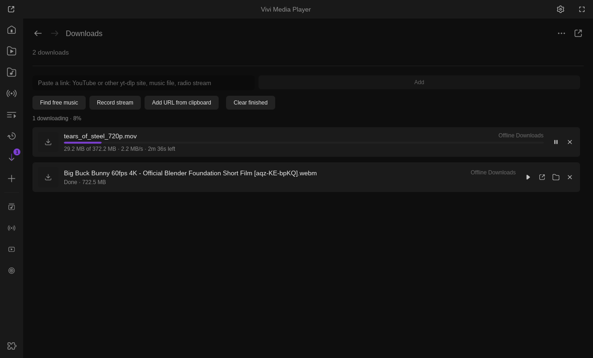

# Offline Downloads

A download queue for offline listening and watching: YouTube and the other sites yt-dlp
supports, direct music files (Jamendo, Internet Archive, any audio / video link) and radio
or live streams recorded for a set time. One download runs at a time; each can be paused,
cancelled and retried.

Install: Vivi → Settings → Extensions → Browse → **Install**. Requires Vivi 0.9.1+; the shared
Downloads panel below needs Vivi 0.13 (or a 0.12.0 build from master of 18 Oct 2026 or later),
older Vivi shows the queue on screen instead.

> **Copyright and Terms of Service.** Download only what you may: your own uploads, content
> under a free licence (Creative Commons, public domain) or what the site allows to be saved.
> Downloading from YouTube and similar sites may violate their Terms of Service and copyright
> law in your country; this plugin is meant for personal offline use, at your own risk.

## Adding downloads

- Paste a URL in Library → **Downloads** (*paste a link* field) or in the plugin's settings and
  press **Add**.
- `Alt+D` adds the URL in the clipboard, or the playing online item when the clipboard has none.
- The player's right-click → Plugins → **Download for offline** (and the palette's *Downloads: add
  the playing stream*) adds what is playing.
- **Record stream** (Downloads panel button, palette, settings) records the playing radio / live
  stream, or the copied URL, for the set length.
- Other scripts: `script-message-to offline_downloads enqueue <url>`. Free Music's *Offline
  Downloads* downloader setting sends its tracks here.

| URL | How |
| --- | --- |
| YouTube, YouTube Music, SoundCloud, Bandcamp, Jamendo / archive.org pages, … | yt-dlp |
| Direct files (`.mp3`, `.flac`, `.ogg`, `.mp4`, …, Jamendo storage, `archive.org/download/…`) | curl, resumable, progress from Content-Length |
| Radio (Icecast / Shoutcast, `.pls` / `.m3u`) | recorded with curl for the set length |
| HLS (`.m3u8`) | recorded with ffmpeg (needs one already installed) |

yt-dlp formats always fall back, so a download no longer fails with "Requested format is not
available" when YouTube offers no single file with video and audio: *Best single file* tries one
file, then merges best video + audio (with ffmpeg), then audio only; the height choices merge up to
that height, then fall back the same way. `music.youtube.com` links are songs: the best audio
(m4a when there is one) is downloaded.

## In Vivi's Downloads panel

Vivi 0.13 has one **Downloads** panel for every extension (Library → Downloads, also from the
tray). This plugin reports its whole queue there: title, progress, size, speed and time left,
"Recording · 12:30 of 30 min" for radio, and the error of a failed download. The row buttons act
on that one download: **Pause / Resume** (not for recordings, which cannot continue), **Cancel**
(the row stays as *Cancelled*), **Retry**; Play now, Open file, Show in folder, Remove and Clear
finished are Vivi's. **Show** / `Alt+Shift+D` open the panel. Finished and failed downloads can
raise a desktop notification (Settings → Extensions → Notifications). Older Vivi versions keep
the on-screen list (pending / active / paused / done / failed) with the same actions in the
settings.

The queue is saved in `plugin-data/offline-downloads/queue.json` and continues after a restart.

## Keys

| Key | |
| --- | --- |
| `Alt+D` | add the URL in the clipboard (or the playing online item) |
| `Alt+Shift+D` | show the queue (the Downloads panel on Vivi 0.13) |

## Settings

| Setting | |
| --- | --- |
| URL to download / **Add** / **Add current** | queue a pasted URL or the playing online item |
| **Record** | record the playing radio / live stream for the set length |
| **Show**, **Pause / Resume**, **Cancel**, **Retry**, **Clear** | act on the queue (the Downloads panel has the same per row) |
| Download folder, **Choose…**, **Open** | default `Downloads/Vivi` |
| yt-dlp quality | *Best single file* (default), *Best*, 1080p, 720p, 480p, *Audio only*; merging video + audio needs ffmpeg |
| Radio / live stream recording length | 10, 30 (default), 60, 120 or 240 minutes |
| Which yt-dlp and ffmpeg are used | **Show** tells which copies are found |

## Requirements

Nothing extra is downloaded: yt-dlp is your system copy or the one the **YouTube & yt-dlp**
plugin manages (`plugin-data/youtube/bin`); ffmpeg (for merging best video + audio) is a system one
or one another Vivi plugin already installed. Direct files and radio use `curl` (built into
Windows 10+, macOS and most Linux systems). Permissions: `network`, `filesystem`, `subprocess`.
