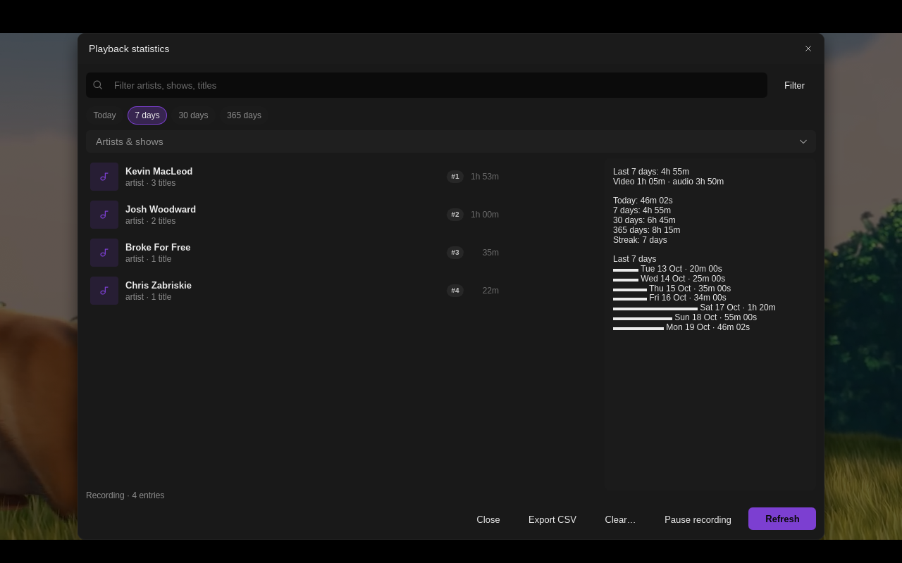
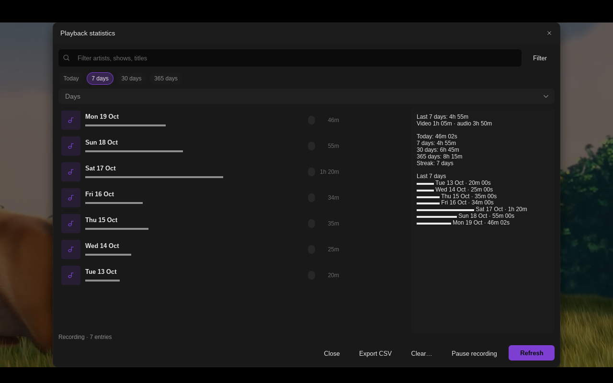
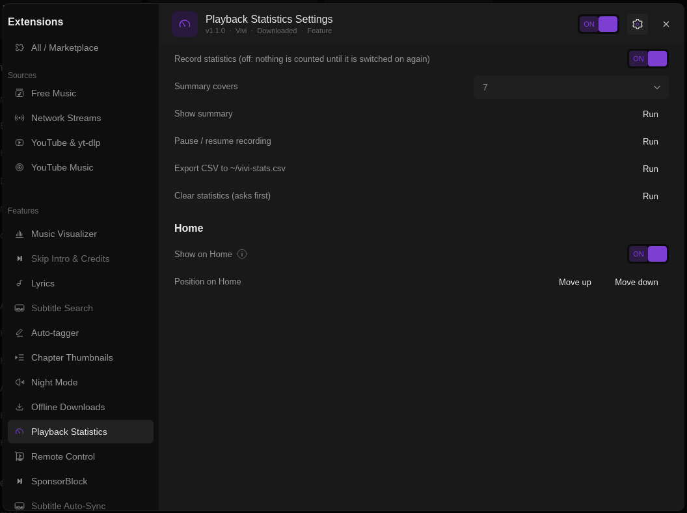

# Playback Statistics

Counts time watched and listened per day, with top artists and shows, today / 7 / 30 / 365-day totals and your day streak. Kept locally in a small TSV file; nothing leaves the machine. Implements #66.

Install: Vivi → Settings → Extensions → Browse → **Install**. Requires Vivi 0.9.0+ (the statistics dialog, Home widget and side-drawer tab need a Vivi build with the plugin host API, 0.13+; older builds get an OSD panel instead; the live Home widget and drawer content need a Vivi build that announces live plugin content, after 0.13.1, and fall back to the dialog otherwise).

## Where to find it

| | |
| --- | --- |
| `Alt+S` | Opens the statistics (press again to close) and shows a one-line toast, e.g. *Today 46m 02s · last 7 days 4h 55m · top: Kevin MacLeod*. On Vivi with live plugin content, while something plays it opens / closes the side-drawer tab instead |
| Home → Widgets | *Playback statistics* card: opens the statistics (show / hide or move it in the plugin's settings). On Vivi with live plugin content the card itself shows today's time, the 7-day total, the streak and a bar per day |
| Player side drawer | *Playback Statistics* tab: Show summary, Pause / resume recording, Export CSV and Clear buttons. With live plugin content it shows today's time, the totals, streak, top artists and shows and the last 7 days with bars, updated while you play; on older Vivi opening it toasts today's numbers |
| Command palette (`Ctrl+K`) | *Show playback statistics*, *Playback statistics: pause / resume recording*, *Playback statistics: export CSV* |

## The statistics dialog

- **Today / 7 days / 30 days / 365 days**: the period (starts at the *Summary covers* setting).
- **Group by**: *Artists & shows* (ranked, with how many titles), *Titles*, or *Days* (a bar per day).
- **Filter**: type part of an artist, show or title (Vivi without the read-only dialog mode; with it the dialog has no search row and no per-row play buttons, and *Days* draws real bars).
- Side pane: the period's total with the video / audio split, today / 7 / 30 / 365-day totals, the streak (days in a row with at least a minute played; until something plays today it counts from yesterday) and bars for the last 7 days. Select a row to see its titles and share instead; **Overview** goes back.
- **Export CSV**, **Clear…** (asks in a confirm dialog), **Pause / Resume recording**.

On Vivi without the host API the same numbers (top 5 and 7 bars) appear in a panel on the video for 8 s, below the title bar.

## Settings

- **Record statistics**: off pauses counting (for a guest, or what you do not want in your history) until it is switched on again; the palette, drawer and dialog buttons do the same and save it here.
- **Summary covers**: 7, 30 or 365 days, the period the dialog opens with; applied live.
- **Show summary**, **Pause / resume recording**, **Export CSV** (writes `~/vivi-stats.csv`: `date,seconds,kind,artist_or_show,title`), **Clear statistics** (asks first; on older Vivi press it twice within 10 s).

## What is counted

Only time that actually plays: pauses, buffering and seeking are left out; at any playback speed it is wall-clock time. Music is grouped by the `artist` tag (else album artist), videos by show, taken from the `show` tag or file names such as `Show S01E02`, `Show.S01.E02` or `Show 1x02`; films without one are listed under *Titles* and count in the totals.

Data lives in `$XDG_DATA_HOME/vivi/plugin-data/playback-stats/stats.tsv` (one line per day and item: date, seconds, kind, artist / show, title), permission `filesystem`. Script messages for `script-message-to playback_stats`: `show`, `open`, `drawer`, `export`, `clear`, `toggle-record`.
