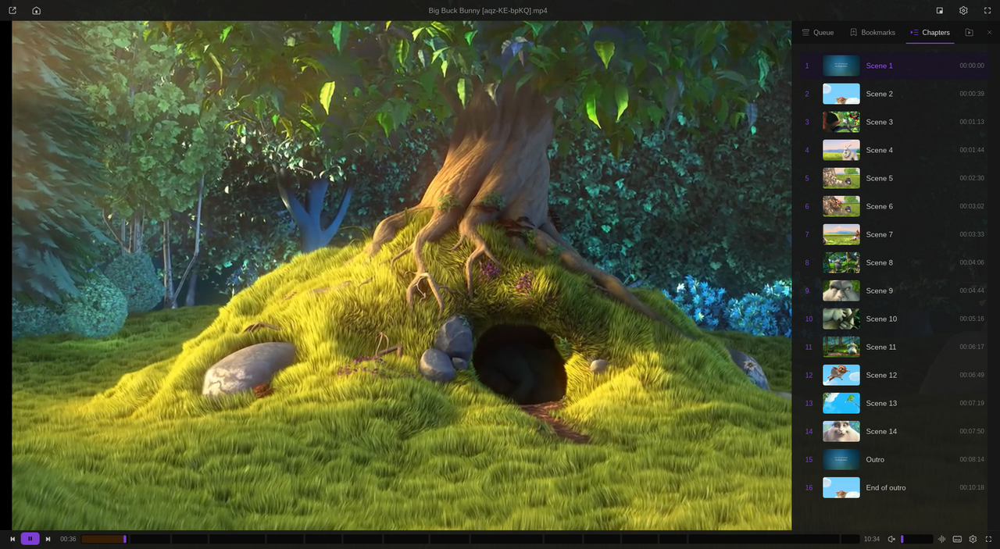
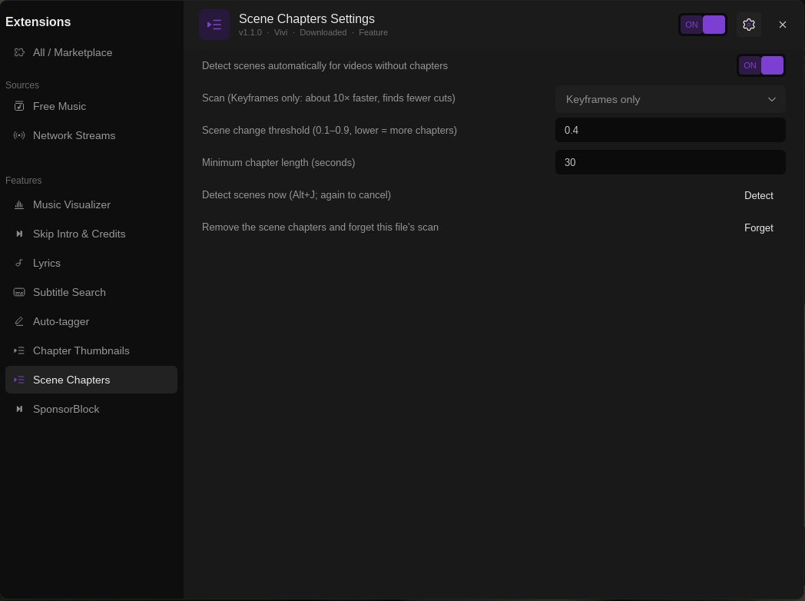

# Scene Chapters

Adds chapters at scene changes to local videos that have none: ffmpeg finds the cuts in the background and they become `Scene 1`, `Scene 2`, … in the seek bar and the side panel's Chapters tab. Implements #62.

> **Deprecated.** Scene detection is now part of [Chapters & Previews](../chapter-thumbnails/README.md) (the Chapter Thumbnails plugin, 1.2.0 or later): the same scan, settings under *Scene chapters*, `Alt+J` and *Video → Detect scene chapters*, automatic detection off by default. With Chapters & Previews installed, Scene Chapters 1.1.1 steps aside (no second `Alt+J` or automatic scan; *Detect* / *Forget* are passed on), copies its non-default settings there once, and its cache is reused. Then uninstall Scene Chapters. Without Chapters & Previews 1.2 it keeps working as described below.

Install: Vivi → Settings → Extensions → Browse → **Install**. Requires Vivi 0.9.0+ and `ffmpeg` (see below).

## Use

- `Alt+J`, *Video → Detect scene chapters*, the command palette (`Ctrl+K`) or *Detect* in the settings. Press `Alt+J` again while it runs to cancel.
- *Detect scenes automatically*: every local video without chapters is scanned one second after it opens (quietly; a toast tells how many chapters were made).
- *Forget* removes the scene chapters from the playing video and deletes its cached scan.

Messages are Vivi toasts, never text over the video.

## How it works

- ffmpeg compares frames (`select='gt(scene,T)'` on a 160 px wide copy, no audio), at the lowest CPU and disk priority (`nice` / `ionice`), so playback does not stutter.
- *Scan*: **Every frame** (default) finds every cut. **Keyframes only** decodes just the keyframes: about 10× faster (a 10-minute 720p60 film: 24 s → 2 s), and encoders put a keyframe at most cuts, so it finds fewer but real ones. Good for long films and automatic mode.
- *Threshold* (0.1–0.9): lower finds more cuts. *Minimum chapter length* (default 30 s) keeps chapters apart, from the start and from the end, so there is no 5-second last chapter.
- Videos with chapters of their own are left alone. Chapters other plugins add are kept and merged in time order: SponsorBlock's segments on a downloaded YouTube video (`Title [id].mp4`) end up between the scenes, whether they arrive before or after the scan.

## Chapter pictures

The pictures in the Chapters tab come from [Chapters & Previews](../chapter-thumbnails/README.md), which redoes them whenever chapters are added or moved. This plugin no longer makes its own (1.0.x did, a second copy of the same pictures); old ones are deleted when a file is opened again.

## ffmpeg

Your `ffmpeg` in `PATH` first; otherwise Vivi's media ffmpeg build if Chapter Thumbnails or Subtitle Auto-Sync already downloaded it (`plugin-data/shared/ffmpeg-media`). This plugin downloads nothing; without either, the toast says so.

## Cache

`~/.local/share/vivi/plugin-data/scene-chapters/<key>/scenes.json` (key = hash of path, size and modification time, so a changed file is scanned again). It keeps every cut found with the threshold and scan used, so changing the minimum length applies at once without a new scan; another threshold scans again.

Script messages: `script-message-to scene_chapters detect` / `clear`; key binding name `scene_chapters/detect`.

