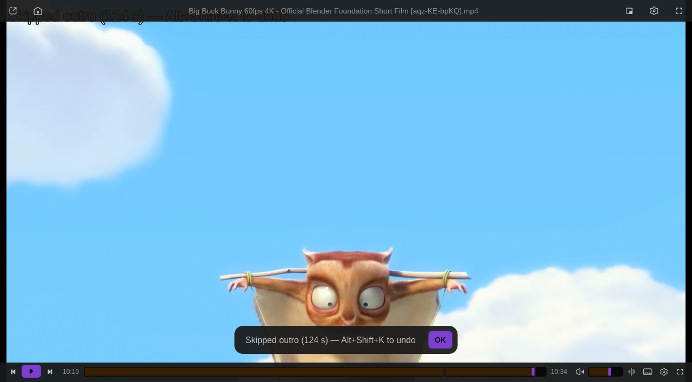

# SponsorBlock

Skips crowd-sourced segments ([SponsorBlock](https://sponsor.ajay.app)) in YouTube videos: sponsors, self-promotion, interaction reminders, intros and more. No account or key. Implements #64 and #73.

Install: Vivi → Settings → Extensions → Browse → **Install**. Requires Vivi 0.9.0+.

## What it works on

- YouTube videos opened as a stream (Open Network Stream with a `youtube.com/watch?v=`, `youtu.be/`, `/shorts/`, `/live/`, `/embed/` or `music.youtube.com` URL; needs yt-dlp), including the entries the YouTube plugin adds to the playlist.
- Downloaded files named like yt-dlp output, `Title [aqz-KE-bpKQ].mkv`: looked up by the id in brackets (setting *Also for downloaded files…*).

## Keys

| Key | |
| --- | --- |
| `Alt+K` | skip the current (or announced) segment |
| `Alt+Shift+K` | undo the last skip: back to where it happened, the segment then plays through. No time limit, it always undoes the most recent skip. Inside a muted segment it unmutes it. |

The *Undo* button in the plugin's settings does the same as `Alt+Shift+K`.

## Settings

- **Categories**: space-separated, default `sponsor selfpromo interaction`; also `intro`, `outro`, `preview`, `music_offtopic`, `filler`.
- **When a segment starts**: *Skip automatically* (a toast says what was skipped and offers undo) or *Ask*: a toast offers `Alt+K` to skip.
- **Per category**: overrides the mode for single categories, e.g. `intro=ask outro=skip filler=off`. `skip` and `ask` work for any category (it is fetched even when not in *Categories*); `off` ignores it.
- **Mute segments**: segments the community marked for muting (actionType `mute`, e.g. a short spoken ad over the video) are muted instead of skipped, and the sound comes back right after. If you muted Vivi yourself, it is left alone. On by default.
- **Mark segments as chapters**: adds chapters at segment start/end so they show on the seek bar (`Sponsor`, `End of sponsor`, `Self-promotion (muted)`, …).
- **Show a notice with undo**: the toast after each skip (off: skip silently).
- **API server**: another SponsorBlock-compatible server.

## Privacy

Lookups use the hash-prefix API (`/api/skipSegments/<first 4 hex of sha256(video id)>`), so the server does not learn which video you watch. Hashing uses `sha256sum` / `shasum` when present, else the plain `?videoID=` API. Requests go through `curl` (permissions: `network`, `subprocess`).
