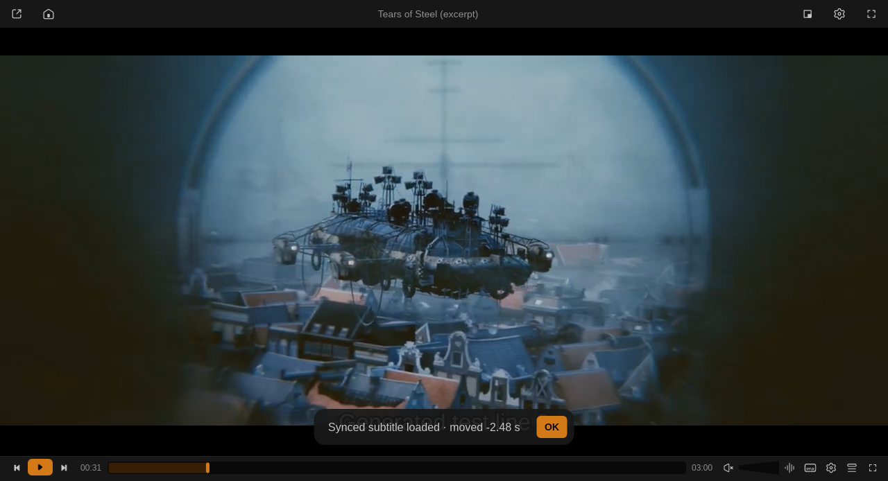

# Subtitle Auto-Sync

Aligns the selected **external** subtitle to the audio, or to another subtitle track, with
[alass](https://github.com/kaegi/alass) or [ffsubsync](https://github.com/smacke/ffsubsync),
and keeps manual subtitle offsets per file. Implements #56 and #72.

Install: Vivi → Settings → Extensions → Browse → **Install**. Requires Vivi 0.9.0+. From
Vivi 0.13 the manual offset is part of the player itself and this plugin only syncs.

## Sync to the audio

- `Alt+Y`, Subtitles menu → *Auto-sync subtitles*, the side panel's *Auto-sync to audio*
  button (Vivi 0.11+) or Settings → Extensions → *Sync current subtitle to the audio*.
- It runs in the background; a toast says when it starts and when it is done, and how far
  the subtitle moved (`moved +2.5 s`, or `(3 parts)` when alass shifted parts of it by
  different amounts, e.g. around an ad break that the subtitle's source did not have).
- The result is `<name>.synced.<ext>`, saved next to the original and selected. Its track
  keeps the original's language and title with `(synced)` added. Syncing again starts
  from the original file (not the already shifted copy) and replaces the loaded copy.
- A manual offset still set for the file is reset, since the synced copy is aligned
  already (the toast says so).
- Only the audio track alass / ffsubsync pick (normally the first one) is used.

## Sync to another subtitle track

`Alt+Shift+Y`, Subtitles menu → *Sync subtitles to another track* (Vivi newer than 0.12)
or Settings → Extensions → *Sync current subtitle to another subtitle track*.

Aligns the selected external subtitle to a subtitle that is known to be in time, typically
an embedded track in another language: it takes seconds instead of minutes and works when
the audio is a poor guide (a dub, songs, long silent parts). The reference is

1. the **secondary subtitle**, when one is shown, else
2. another **text** subtitle track of the file: embedded tracks first (they come with the
   video), tracks marked forced last.

An external reference is used as it is (no ffmpeg needed). An embedded one is first read
from the video with an installed ffmpeg (Vivi's shared ffmpeg build has no subtitle
decoders). Bitmap subtitles (PGS, VobSub, DVB) cannot be a reference.

## When the file opens again

With *Use the synced copy when a file opens with the original subtitle* (on by default),
opening the file with `movie.en.srt` selected switches to `movie.en.synced.srt` when that
exists and is not older than the original (a replaced original is left alone). Choosing the
original again by hand afterwards is not undone.

## Sync tools and downloads

- Order: an installed `alass` / `alass-cli`, then `ffsubsync` (PATH, `~/.cargo/bin`,
  `~/.local/bin`, Homebrew…), or the one picked in *Sync tool*.
- Nothing installed: alass 2.0.0 is downloaded once from its official GitHub release and
  checked against the sha256 pinned in the script: **3 MB** on Linux x86_64, **26 MB** on
  Windows (the Windows build bundles its own ffmpeg). It lives in
  `~/.local/share/vivi/plugin-data/subtitle-sync/alass`. Turn off *Download alass* to
  never download.
- Reading the audio needs ffmpeg + ffprobe (alass and ffsubsync both): an installed ffmpeg
  is used when present, otherwise Vivi's **media ffmpeg build** (`helper-ffmpeg-v8.0-2`,
  about 15 MB for both, shared with Chapter Thumbnails in `plugin-data/shared/ffmpeg-media`)
  is downloaded on the first sync to the audio. Vivi itself ships no ffmpeg program.
- macOS and Linux ARM have no alass build: `cargo install alass-cli` or
  `pip install ffsubsync`.
- *Which sync tool and ffmpeg are used* shows what was found.
- The Flatpak cannot run host programs, so there only the downloaded alass and ffmpeg are
  used.

Embedded subtitle tracks cannot be synced themselves (they come timed with the video).

## Manual offset

**Vivi 0.13 and newer** handle the offset themselves, with or without the Subtitle Search
plugin: `Z` / `X` and `Alt+Z` / `Alt+X` move the subtitle 0.1 s (`Shift`: 1 s), side panel →
Subtitles → Offset has the same buttons and a reset, MCP has `set_subtitle_offset`, and the
value is saved per file and restored when it opens again. Vivi says so with
`user-data/vivi/sub-offset = 1`; the plugin then binds no offset keys (`Alt+Backspace` still
resets, through Vivi) and keeps no file of its own. Offsets it saved on an older Vivi are
imported by Vivi once (Vivi writes `plugin-data/subtitle-sync/offsets.imported`) and the
plugin's `offsets.json` is removed. The side panel's *Auto-sync to audio* button (and MCP
`sync_subtitles`) runs this plugin's sync.

Older Vivi, where the plugin has its own keys:

| Key | |
| --- | --- |
| `Alt+Z` / `Alt+X` | subtitle one step earlier / later (*Offset step*, 0.1 s by default) |
| `Alt+Shift+Z` / `Alt+Shift+X` | ten steps (1 s by default) |
| `Alt+Backspace` | reset |

- Vivi 0.11 / 0.12 with Subtitle Search on (script-opt `vivi-sub-offsets=1`): the keys send
  `script-message vivi-sub-offset set:<seconds>` and Vivi applies, saves and shows the value;
  an offset saved here earlier is handed over when its file opens.
- Otherwise the offset is saved per file (path + size) in
  `plugin-data/subtitle-sync/offsets.json` and applied as `sub-delay` every time the file
  is opened again.

## Settings

- **Sync tool**: *Auto*, *alass* or *ffsubsync*.
- **Download alass when no sync tool is installed**: on by default.
- **Offset step** (Vivi before 0.13): 0.1 s, 0.05 s, 0.25 s or 0.5 s (Shift: ten steps).
- **Use the synced copy when a file opens with the original subtitle**: on by default.
- Buttons: *Sync current subtitle to the audio*, *… to another subtitle track*, *Reset the
  subtitle offset of this file*, *Which sync tool and ffmpeg are used*.

Script messages (`script-message-to subtitle_sync <name>`): `sync`, `sync-ref`, `reset`,
`detect`.
