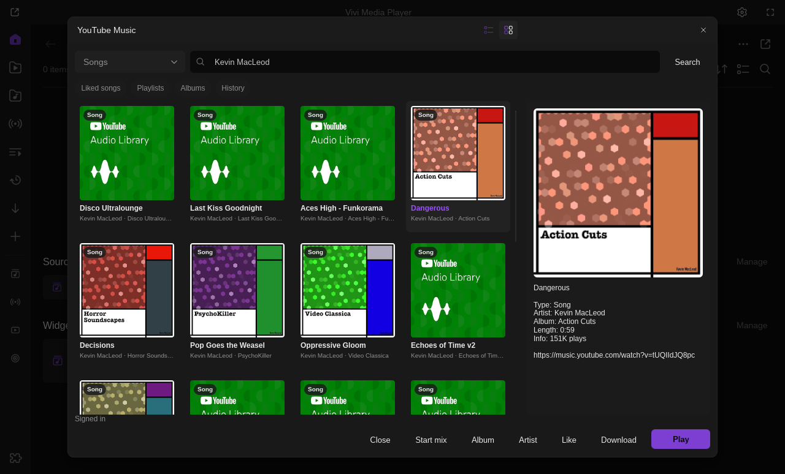
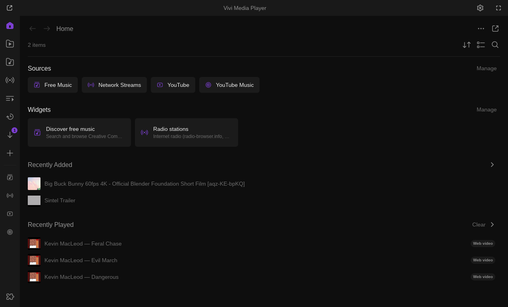
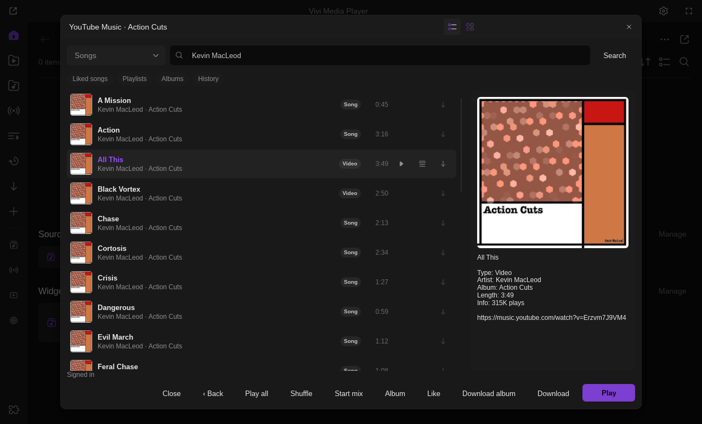
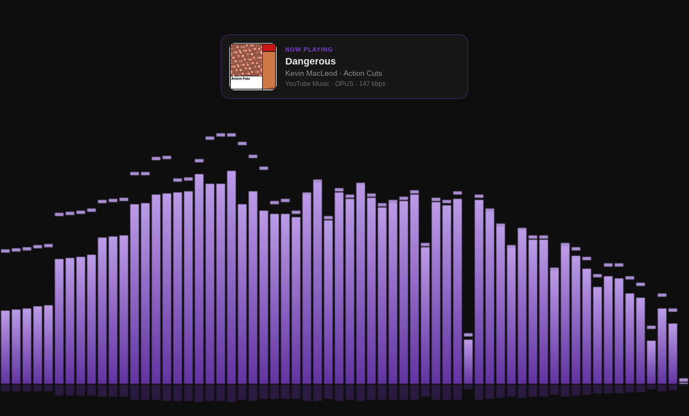
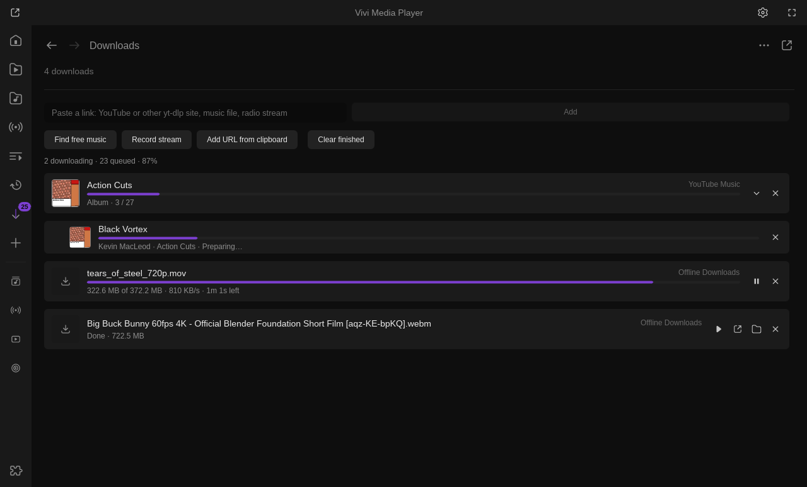

# YouTube Music

Your own YouTube Music account in Vivi: search, your library, album / playlist / artist pages,
up next and mixes, likes, adding to playlists and (opt-in) downloads, in Vivi's music dialog.
Search works without signing in.

Install: Vivi → Settings → Extensions → Browse → **Install** (off by default: turn it on in
Extensions). Requires a Vivi with the music dialog for plugins: Vivi 0.13, or a 0.12.0 build from
master of 18 Oct 2026 or later (`vivi-git`, or your own build). The catalog lets 0.12.0 install it,
because master builds still report 0.12.0; on the 0.12.0 release (and older) **Open YouTube Music**
only shows a toast saying a newer Vivi is needed. Also needs `curl` (built into Windows 10+, macOS
and most Linux systems) and `yt-dlp` for playback (install it, or the **YouTube & yt-dlp** plugin,
which downloads a managed copy that Vivi finds by itself).

> **Unofficial.** This plugin uses YouTube Music's web API (InnerTube), the way the web app
> and ytmusicapi do. It is not a Google-approved app: it may break whenever Google changes
> the site, and Google may restrict accounts that use unofficial clients. Use it at your own
> risk.

## Sign in

1. Sign in at <https://music.youtube.com> in your browser.
2. In Vivi open **Extensions** (`Ctrl+E`) → **YouTube Music** → settings (gear), then one of:
   * pick the browser under *Browser you are signed in with* and press **Sign in**
     (yt-dlp `--cookies-from-browser`; Chrome-based browsers may ask for the keyring
     password; on Windows close Chrome / Edge first if reading fails);
   * or export a `cookies.txt` (Netscape format, e.g. with a "Get cookies.txt" browser
     extension), or save the request headers of a music.youtube.com request (devtools →
     Network → a `browse` request → *Copy request headers*) to a file, put its path in
     *cookie file* and press **Import**;
   * or copy those request headers, or *Copy as cURL*, and press **Paste**.
3. The plugin checks the cookies with YouTube Music and shows "Signed in as …".

Google rotates the browser's session cookies, so an imported copy stops working after a
while. When the library opens with cookies older than 20 minutes, or YouTube Music answers
as signed out, the plugin reads the browser named in the settings again, silently, and keeps
the account only if it is the same one. Pasted or imported cookies cannot be refreshed: sign
in with the browser to stay signed in.

## Privacy

Only the youtube.com cookies are kept, in `~/.local/share/vivi/plugin-data/youtube-music/cookies.txt`
(folder 0700, file 0600; `%USERPROFILE%\.local\share\…` on Windows). They are sent only to
music.youtube.com (and to yt-dlp for playback / downloads), never logged, and requests pass
them to curl in a private config file, not on the command line. **Sign out** overwrites and
deletes the file; your browser stays signed in (sign out there, or at
myaccount.google.com, to end the session).

## Use

* **Open YouTube Music** (sidebar → Sources, the command palette `Ctrl+K`, or the plugin's
  settings): search songs, albums, artists, playlists or videos (the dropdown), or pick
  **Liked songs**, **Playlists**, **Albums** or **History**. The list / grid buttons switch
  between rows and cover tiles; arrow keys, Home / End and Enter work in both.
* **Play** a song from search: it plays, followed by YouTube Music's up next (setting).
  From a list, the rest of the list follows. **Open** an album, playlist or artist page;
  **Play all**, **Shuffle** and **Queue** put its tracks in Vivi's playlist.
* **Start mix** queues the song's radio; the player's right-click → Plugins and the tray
  menu have *Start radio from this song* and *Like this song* for the playing track (also
  for a song this plugin downloaded).
* **Like** / **Unlike**, and the *Add to playlist* dropdown adds the selected song to one of
  your playlists.
* Songs you downloaded already have a check mark on their tile / row; the detail pane shows
  the selected item's cover large.
* The now-playing card shows title, artist, album and cover. With a Premium account
  yt-dlp picks the Premium audio formats.

## Downloads (off by default)

> **Copyright and Terms of Service.** Downloading from YouTube Music may violate YouTube's
> Terms of Service and the copyright of the music. Downloads are off by default; turn them
> on only for personal offline use of what you may keep, at your own risk.

Turning on **Allow downloads** first shows that warning in Vivi's confirm dialog, and nothing
is downloaded until you accept it. After you accept,
**Download** (in the dialog or the player's right-click menu) saves the track to
`~/Music/vivi/<Artist>/<Album>/<NN> <Title>.<ext>` (folder setting; the track number only
for songs downloaded from an album page, `Singles` without an album, ` [video id]` only
when another song already has that name) with tags (title, artist, album, album artist,
track number, year) and the square album cover embedded (ffmpeg: the system one, or the
YouTube plugin's managed copy; opus covers without yt-dlp's mutagen are written by
ffmpeg), as the original stream (AAC / Opus, no re-encode) or m4a / mp3 / opus. A song
already downloaded to that folder in that format is not downloaded again. Progress shows in the
dialog's status line (Linux / macOS) and, on Vivi 0.13+, in Library → **Downloads** with
the other plugins' downloads (Cancel, Retry, Play now, Show in folder);
**Cancel downloads** stops them all.

### Whole playlists, albums and liked songs

On a playlist or album page (or with one selected in a list, or in **Liked songs**),
**Download playlist** / **Download album** fetches every track (all pages, up to 5000),
downloads the ones not on disk yet into the same `<Artist>/<Album>` folders (a song
downloaded before, in any format, is reused, so a song in several playlists is one
file) and saves a Vivi playlist in YouTube Music's order:
`~/.local/share/vivi/playlists/<Name>.m3u` with the square playlist cover as
`<Name>.jpg`. Album tracks keep their track numbers; playlist positions are not used as
track numbers. The tracks are downloaded one at a time, 2 s apart; when YouTube starts
limiting ("429", "not a bot") the playlist stops and Sync later continues it.

**Sync playlist** (same button once downloaded, the palette's *YouTube Music: sync
downloaded playlists* for all of them, or on Vivi 0.13+ **Sync** in the playlist's menu
in Library → Playlists) downloads new tracks and rewrites the playlist; tracks removed
on YouTube Music drop out of the list, their files stay. Edits you make to the playlist
are replaced by the next sync; delete it to stop syncing. A playlist of yours with the
same name is never overwritten: the download is saved as `<Name> (YouTube Music).m3u`.
The playlist carries `#VIVI-SOURCE:youtube-music <id>` in its header, and the plugin
keeps the list of synced playlists in `plugin-data/youtube-music/playlists.json`.

On Vivi 0.13+ the playlist is written by Vivi (`vivi-playlist`): Library → Playlists
shows a *YouTube Music* badge with **Sync** and **Open Source**, and Library →
Downloads shows the playlist as one row ("12 / 40") with its tracks under it. Older
Vivi builds get the same file, written by the plugin.

## Where it shows up

| Where | What |
| --- | --- |
| Sidebar / Home → Sources | **YouTube Music** opens the dialog |
| Command palette (`Ctrl+K`) | *Search YouTube Music*, *YouTube Music: liked songs*, *YouTube Music: sync downloaded playlists* |
| Player right-click → Plugins | *Start radio from this song*, *Download this song*, *Like this song on YouTube Music* |
| Tray menu | *YouTube Music: like this song*, *YouTube Music: start radio from this song* (a tray click only likes, never unlikes) |
| Notifications | download finished or failed (Settings → Extensions → Notifications) |

In the dialog the arrow keys and `Home` / `End` move through rows and tiles, `Enter` plays or
opens the selected item. The plugin binds no player keys of its own.

## Settings

| Setting | Default | |
| --- | --- | --- |
| **Open YouTube Music** | | the dialog |
| Browser you are signed in with | Firefox | Firefox, Chrome, Chromium, Brave, Edge, Opera, Vivaldi, Safari, Whale |
| **Sign in** | | reads that browser's youtube.com cookies (yt-dlp; the desktop keyring for Chrome-based browsers) |
| Cookie file / **Import** | empty | a `cookies.txt` or saved request headers |
| **Paste** | | a Cookie header, request headers or *Copy as cURL* from the clipboard |
| **Sign out** | | overwrites and deletes the stored cookies |
| Up next after a song played from search | on | YouTube Music's up next follows the song |
| Audio only | on | off: music videos play as video |
| Results view | List | List or Grid (also the buttons in the dialog) |
| Allow downloads | off | asks first (see above) |
| Download folder | `~/Music/vivi` | |
| Download format | Original (m4a / opus, no re-encode) | or m4a, mp3, opus (ffmpeg) |
| **Cancel downloads** | | stops the running download and empties the queue |

Permissions: `network` (music.youtube.com, the covers), `filesystem` (cookies, downloads,
playlists), `subprocess` (curl, yt-dlp, ffmpeg).
